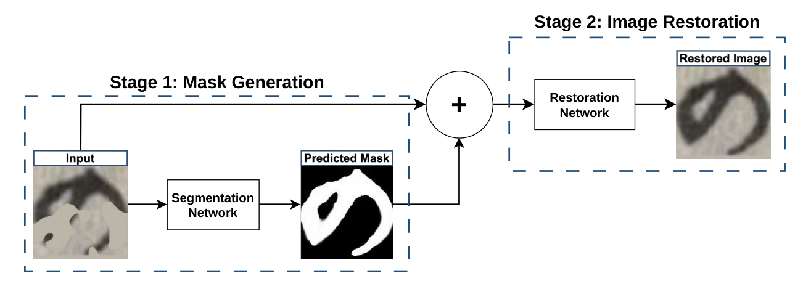
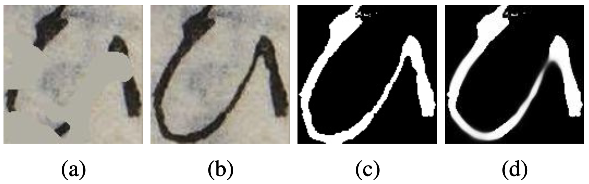
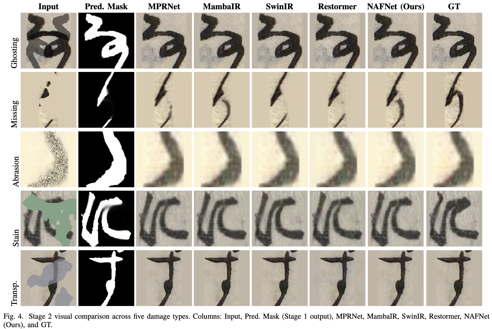
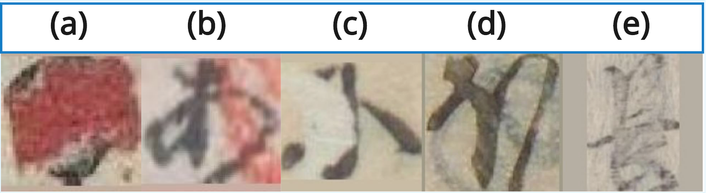
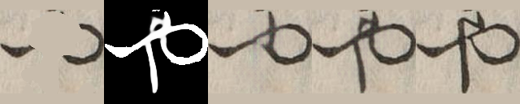
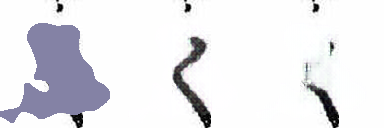

# Kuzushiji Restoration: Mask-Guided Two-Stage Framework

<p align="center">
  <a href="https://www.python.org/downloads/"></a>
  <a href="https://pytorch.org/"></a>
  <a href="LICENSE"></a>
  <a href="https://github.com/imoto135/Kuzushiji_Restoration/stargazers"></a>
  <a href="https://github.com/imoto135/Kuzushiji_Restoration/issues"></a>
</p>

> **個人研究プロジェクト** — 物理的に損傷した*くずし字*（古典日本語くずし字）文書の復元に向けた、マスクガイド付き二段階フレームワークの設計・実装・比較評価

---

## 概要

くずし字の単文字画像に人工的な汚れや欠損を加え、文字領域の推定と画像復元の2段階で元の画像に近づける研究です。

**元画像（正解画像・GT）**は、人工的な劣化を加える前の画像を指します。Stage 1では元画像から作った文字領域マスク、Stage 2では元画像そのものを正解として学習します。

<details>
<summary>処理の流れを見る</summary>

```text
損傷画像 LQ（RGB、128×128）
    │
    ├── Stage 1: UNet++ → 文字領域確率 M̂ ∈ [0,1]（1ch）
    │                                      │
    └──────────── RGB + M̂（4ch）────────────┘
                         │
       Stage 2: NAFNet / SwinIR / Restormer / MPRNet / MambaIR
                         │
                    復元画像（RGB、3ch）
```

</details>

マスクは**文字領域（文字=1、背景=0）**を表します。Stage 1とStage 2はそれぞれ別に学習します。

<p align="center">
  
  
  
</p>

学習設定は現行コード・YAMLに基づきます。報告結果との対応が未確認の項目は、末尾の[要確認事項](#要確認事項)にまとめています。

- [実験データ](#実験データ)
- [Stage 1：文字領域推定](#stage-1文字領域推定)
- [Stage 2：マスクガイド付き復元](#stage-2マスクガイド付き復元)
- [要確認事項](#要確認事項)

## 実験データ

ひらがな78クラスの単文字画像（128×128）を対象に、汚れ・半透明汚れ・欠損・裏写り・摩耗の5種類を合成します。

<p align="center">
  
</p>
<p align="center">
  <em>(a) 汚れ(Stain) &nbsp;|&nbsp; (b) 半透明汚れ(Transparent Stain) &nbsp;|&nbsp; (c) 欠損(Missing) &nbsp;|&nbsp; (d) 裏写り(Ghosting) &nbsp;|&nbsp; (e)摩耗(Abrasion)</em><br>
  <sub>実際の古典文書に見られる5種類の物理的劣化。繊細な筆跡と重なるため、原本の墨跡との区別が困難。</sub>
</p>

<details>
<summary>データ分割・前処理・劣化合成の詳細</summary>

### データと分割

| 項目 | 内容・確認元 |
|---|---|
| 対象 | CODHくずし字データセット由来の単文字画像。既存の復元比較はひらがな78クラス |
| 画像サイズ | 128×128、RGB。縦横比を保ってリサイズし、背景色の中央値で余白を埋める |
| 分割 | 原稿ではtrain / val / test ≈ 8:1:1。前処理コードは分割済みのディレクトリを読み込む |
| 原稿の件数 | `sots.tex`付録：train 108,123 / val 13,562 / test 13,567、計135,252枚。実データとの一致は未確認 |
| Stage 1のモデル選定 | `sots.tex`では「あ・い・う・え・お・か・き・く」の8クラス。78クラスの復元比較と区別する |
| 正解画像（GT） | 人工的な劣化を加える前の元画像 |
| 入力画像（LQ） | 元画像に劣化を合成した画像 |
| 正解文字マスク | 元画像をOtsu法で二値化。文字255、背景0 |
| 予測文字マスク | Stage 1が出力する文字領域の確率。0〜255のグレースケール画像で保存 |

実験機材は原稿にNVIDIA RTX A6000×2（各48 GB）と記載されています。現行のBasicSR系設定は1実験あたりGPU 1枚です。

### 劣化合成

[03_add_stain_5types.py](scripts/data_preprocessing/03_add_stain_5types.py)は、**元画像1枚につき以下の5種類から1つをランダムに選んで1枚生成**します。

| コード上の名前 | 合成処理 |
|---|---|
| `Missing` | ランダムな領域を背景色（各チャンネルの最頻値）で置換 |
| `Stain` | ランダムな斑点領域を不透明な汚れ色で置換 |
| `Scratch` | 細かなランダム領域を背景色で置換。既存図表では摩耗・Abrasionとも表記 |
| `Ghosting` | 左右反転した文字画像から濃淡マップを作り、入力に乗算 |
| `Transparent_Stain` | 汚れ色をalpha=0.3〜0.8で混合 |

劣化合成の乱数seedの既定値は42です。画像の列挙順は固定されていません。

</details>

## Stage 1：文字領域推定

### 目的とモデル

損傷RGB画像から、元画像に存在する文字領域を推定します。元画像のOtsuマスクを教師にすることで、劣化箇所を人手でラベル付けせずに学習できます。出力はsigmoid確率で、Stage 2には二値化せずに渡します。

<details>
<summary>Stage 1のモデル構成・学習設定・評価方法</summary>

### 現行コードの学習設定

[学習コード](models/unet++/train.py)の既定値・固定値を示します。

| 項目 | 設定 |
|---|---|
| アーキテクチャ | SMP `UnetPlusPlus`、入力3ch、出力1ch（logits） |
| エンコーダ | `se_resnext50_32x4d`、ImageNet事前学習 |
| 深さ・デコーダ | depth=5、channels=(256,128,64,32,16) |
| 注意機構 | **現行コードは`decoder_attention_type='scse'`**。既存結果の採用構成とは要照合 |
| 入力 | 128×128、ImageNet mean=(0.485,0.456,0.406)、std=(0.229,0.224,0.225)で正規化 |
| 損失 | `0.5 × DiceLoss(binary) + 0.5 × BCEWithLogitsLoss` |
| Optimizer | AdamW、lr=1e-4、weight_decay=1e-5、betasはPyTorch既定値(0.9,0.999) |
| Scheduler | ReduceLROnPlateau、検証IoU最大化、factor=0.2、patience=3 |
| 学習期間 | 最大100 epochs、Early Stoppingは検証IoUが10 epochs改善しなければ停止 |
| バッチサイズ | 256（現行コードの既定値。原稿は16） |
| データ拡張 | HorizontalFlip p=0.1、Rotate ±10° p=0.3、CoarseDropout p=0.5 |
| CoarseDropout | 入力のみ黒塗り、矩形1個、高さ・幅それぞれ16〜32 px、教師マスクは保持 |
| 精度・乱数 | CUDA AMP（FP16）、seed=42、cuDNN deterministic有効 |
| モデル選択 | 検証IoUが最高の重み |

評価はF1・Hard IoU（閾値0.5）、Soft IoU・MAE（確率値）を使用します。学習時の検証IoUはバッチ単位、結果評価は画像単位で集計します。

</details>

### Stage 1の報告結果

モデル選定は8クラスで実施した報告値です。

**アーキテクチャ比較**（エンコーダー: SE-ResNeXt50 に統一、CD = Coarse Dropout）

| モデル | F1-score↑ | Hard IoU↑ | Soft IoU↑ | MAE↓ |
| :--- | :---: | :---: | :---: | :---: |
| DeepLabV3+ | 0.8295 | 0.7420 | 0.6986 | 0.0989 |
| U-Net | 0.9669 | 0.9409 | 0.9278 | 0.0180 |
| UNet++ | 0.9699 | 0.9472 | 0.9345 | 0.0176 |
| **UNet++ + CD (採用)** | **0.9719** | **0.9504** | **0.9406** | **0.0155** |

> Coarse Dropoutを加えた既存報告ではF1=0.9719 / Hard IoU=0.9504でした。周辺の文脈から筆画を補う効果が考えられますが、数値だけで内部機構を特定したものではありません。

<details>
<summary>UNet++の内部構造アブレーションを見る</summary>

UNet++ (Encoder: SE-ResNeXt50) に対し、構造・正則化の各変更が精度に与える影響を体系的に検証しました。

| Configuration | F1-score↑ | Hard IoU↑ | Soft IoU↑ | MAE↓ |
| :--- | :---: | :---: | :---: | :---: |
| Baseline (Depth 5) | 0.9699 | 0.9472 | 0.9345 | 0.0176 |
| Depth 3 | 0.9698 | 0.9466 | 0.9353 | 0.0161 |
| Depth 4 | 0.9703 | 0.9479 | 0.9376 | 0.0163 |
| + scSE Module | 0.9690 | 0.9446 | 0.9329 | 0.0165 |
| + Half Channels + Head Dropout | 0.9702 | 0.9475 | 0.9388 | 0.0158 |
| Dropout (Last Layer only) | 0.9655 | 0.9359 | 0.9291 | **0.0123** |
| Head Dropout (0.5) | 0.9702 | 0.9475 | 0.9388 | 0.0158 |
| Input Dropout + Depth 4 | 0.9708 | 0.9487 | 0.9391 | 0.0159 |
| **Input Dropout + Depth 5 (採用)** | **0.9719** | **0.9504** | **0.9406** | 0.0155 |

- **深さ**: Depth 4はBaselineよりMAE・Soft IoUが改善。Depth 5 + Input Dropoutは掲載構成中でF1・Hard IoUが最高でした。
- **scSE Module**: 掲載結果ではBaselineよりIoUが低下。既存の考察は弱い筆画の過剰抑制ですが、現行コードでの採用有無と結果との対応には確認が必要です。
- **Input Dropout (Coarse Dropout)**: 入力に矩形の欠損を作り、教師マスクを保ったまま学習します。Depth 5との組合せでF1・Hard IoUが最高でした。

</details>

## Stage 2：マスクガイド付き復元

### 比較条件

| 条件 | 入力 | 用途 |
|---|---|---|
| NoMask | 損傷RGBのみ、3ch | マスクを使用しない比較 |
| PredMask | 損傷RGB + Stage 1予測文字マスク、4ch | 推論時にも利用できる提案構成 |
| GTMask | 損傷RGB + 元画像由来のOtsuマスク、4ch | 正解文字領域を与える参照条件。実運用時には利用不可 |

GTMaskは「正解マスクを与えた比較」であり、すべての指標の理論的上限を保証するものではありません。RGB・マスクを[0,1]にスケーリングし、3chの元画像（RGB）を教師にします。

<details>
<summary>Stage 2のモデル構成・損失関数・学習設定</summary>

### アーキテクチャの設定

| モデル | 現行コード・代表YAMLの構成 |
|---|---|
| NAFNet | width=32、encoder blocks=[2,2,4,8]、middle=12、decoder blocks=[2,2,2,2] |
| SwinIR | embed_dim=60、depths=[6,6,6,6]、heads=[6,6,6,6]、window=8、MLP ratio=2、upscale=1、upsamplerなし |
| Restormer | dim=48、blocks=[4,6,6,8]、refinement=4、heads=[1,2,4,8]、FFN expansion=2.66、LayerNorm=WithBias |
| MPRNet | n_feat=40、scale_unetfeats=20、scale_orsnetfeats=16、num_cab=4、kernel=3、reduction=4 |
| MambaIR | embed_dim=64、depths=(4,4,4,4)、d_state=16、upscale=1 |

### 損失関数

基本構成は**Charbonnier Loss + 0.1 × 知覚損失**です。知覚損失の実装はモデルによって異なります。

| モデル | 画素損失 | 知覚損失 |
|---|---|---|
| NAFNet / SwinIR / Restormer | `mean(sqrt(error² + 1e-12))` | VGG19の`conv5_4`特徴間のL1距離 |
| MPRNet | 同上。内部の3段出力に重み1.0 / 0.5 / 0.25で加算 | 同上。最終出力に適用 |
| MambaIR | `mean(sqrt(error² + (1e-3)²))` | LPIPS（VGG版） |

VGG19特徴の計算ではImageNet正規化、LPIPSでは入力を[-1,1]に変換します。

### 学習ハイパーパラメータ（現行ファイル）

PredMaskの代表設定を示します。モデル間・マスク条件間で学習条件は異なります。

| モデル | バッチ | 学習率 | 学習上限 | 検証間隔（iter） | 早期終了 |
|---|---:|---|---|---:|---|
| NAFNet [設定](models/nafnet/options/Kuzushiji/mask_charb_percep.yml) | 64 | 1e-3 | 200 epochs | 5,000 | PSNR最大、15回改善なし |
| SwinIR [設定](models/swinir/options/Kuzushiji/SwinIR_PredMask_charb_percep.yml) | 16 | 2e-4 | 200,000 iter | 5,000 | PSNR最大、15回改善なし |
| MPRNet [設定](models/mprnet/options/Kuzushiji/MPRNet_PredMask_charb_percep.yml) | 32 | 2e-4 | 200,000 iter | 2,500 | PSNR最大、15回改善なし |
| Restormer [設定](configs/restormer/restormer_charb_percep.yml) | 8 | 2e-4 | 200,000 iter | 2,500 | 設定なし |
| MambaIR [コード](models/mamba/train_mamba_5stain.py) | 16 | 2e-4 | 200,000 iter | 5,000 | 実装なし、検証PSNR最高を保存 |

### Optimizer・拡張・条件別の設定詳細

OptimizerはすべてAdamWです。

| モデル | betas | weight decay |
|---|---|---:|
| NAFNet / MambaIR | (0.9, 0.9) | 0 |
| SwinIR | (0.9, 0.99) | 0 |
| MPRNet / Restormer | (0.9, 0.999) | 1e-4 |

- Scheduler：YAML系はCosineAnnealingRestartLR、restart_weights=[1]、eta_min=1e-7。MambaIRはCosineAnnealingLR、T_max=`total_iters`、eta_min=1e-7。
- NAFNet PredMaskのcosine期間は339,200 iter固定です。`run_train.py`では`total_epoch`指定時に実データ数から学習上限を再計算しますが、scheduler期間は自動調整しません。
- 乱数：NAFNet・SwinIR・MPRNetの掲載YAMLはseed=10、Restormer PredMaskは100、NoMaskは10。MambaIRの学習スクリプトにはseed固定がありません。
- データ拡張：掲載NAFNet・SwinIR・MPRNet・Restormer NoMaskは128×128 crop、flip/rotationなし。Restormer PredMaskのYAMLはflip/rotationとgeometric augmentationが有効。MambaIRはResizeと±10°回転（p=0.3）。
- 精度：NAFNet・SwinIR・MPRNet・Restormer NoMaskのYAMLは`use_amp: true`。Restormer PredMaskのYAMLに同項目はありません。MambaIRはBF16 autocast、勾配clip norm=0.01。
- Early Stoppingの「回」は検証回数です。`run_train.py`では設定指標が検証ログに存在する場合に判定されます。停止指標の指定と、最終評価に使用した重みの選択は別途確認が必要です。

**マスク条件による違い**

| 系列 | 現行ファイルで確認できる差 |
|---|---|
| NAFNet NoMask | [設定](models/nafnet/options/Kuzushiji/NAFNet_NoMask_charb_percep.yml)は200 epochs、batch=64。`pretrain_network_g`に90,000 iter重みを指定 |
| SwinIR NoMask / GTMask | [NoMask](models/swinir/options/Kuzushiji/SwinIR_NoMask_charb_percep.yml)は1,356,800 iter、70,000 iter重みを指定。[GTMask](models/swinir/options/Kuzushiji/SwinIR_GTMask_charb_percep.yml)は200,000 iter |
| MPRNet NoMask / GTMask | [NoMask](models/mprnet/options/Kuzushiji/MPRNet_NoMask_charb_percep.yml)は678,400 iter。[GTMask](models/mprnet/options/Kuzushiji/MPRNet_GTMask_charb_percep.yml)は200,000 iter。両方batch=32 |
| MPRNet PredMask | 上表の設定に`resume_state`（2,500 iter）が残っている。`configs/nafnet/Kuzushiji/mprnet_mask_charb_percep.yml`はbatch=64で別値 |
| NAFNet 全文字 | `configs/nafnet/Kuzushiji/full_{nomask,mask,gtmask}_charb_percep.yml`は`data/full_padded`、30 epochs、LPIPS最小・patience=10、cosine期間316,320 iter |
| NAFNet GTMask（ひらがな） | `models/nafnet/options/Kuzushiji/gtmask.yml`はPSNR Loss系。既存結果表のCharbPercepと同一設定だと確認できない |

同じiter数でも、バッチサイズが異なれば学習に使う延べ画像数は異なります。

Restormer NoMaskの[別設定](models/nafnet/options/Kuzushiji/restormer_nomask_charb_percep.yml)は、batch=16、lr=3e-4、上限1,356,800 iter、検証5,000 iterごと、PSNRで早期終了（patience=15）です。

</details>

評価は文字領域の画質（mPSNR・mSSIM）、知覚品質（LPIPS）、文字認識精度で行います。↑は高いほど、↓は低いほど良い値です。

<details>
<summary>評価指標・文字認識用分類器の詳細</summary>

### 評価方法

確認元：[calculate_5metrics.py](scripts/evaluation/calculate_5metrics.py)。評価マスクは全条件で**GTの文字領域マスク**を使います。

| 指標 | このスクリプトの計算方法 |
|---|---|
| PSNR ↑ | 画像全体のRGB誤差から算出 |
| SSIM ↑ | グレースケール画像全体で算出 |
| Masked PSNR / mPSNR ↑ | GTマスク>128の画素でRGBのMSEを計算しPSNRに変換 |
| Masked SSIM / mSSIM ↑ | グレースケールのSSIM mapを作り、GT文字領域内で平均。周辺画素もSSIM窓に含まれる |
| LPIPS ↓ | AlexNet版LPIPS、入力を[-1,1]に変換 |

各画像の指標を算出して算術平均します。mPSNRの`m`は**masked（文字領域内）**を指します。↑は高いほど、↓は低いほど良い値です。

### 文字認識評価（OCR精度）

復元した単文字をResNet-18で分類し、78クラスの正解率を測定します。報告されたピーク検証精度は98.7%です。

連続文書の翻刻精度ではなく、復元した**単文字の78クラス分類Accuracy**で評価します。確認元：[train_classifier.py](models/classifier/train_classifier.py) / [evaluate_restoration_hiragana.py](models/classifier/evaluate_restoration_hiragana.py)。

| 項目 | 現行実装・既定値 |
|---|---|
| モデル | ImageNet事前学習ResNet-18、FCを対象クラス数に置換 |
| 入力 | 学習データはグレースケール→RGB、224×224、ImageNet正規化。評価コードはRGB読込 |
| 学習拡張 | RandomRotation ±10°、RandomAffine translate=(0.1,0.1) |
| 損失・Optimizer | CrossEntropy、SGD lr=1e-3、momentum=0.9、weight_decay=1e-4 |
| 学習期間 | 最大50 epochs、batch=128、Early Stoppingは検証Accuracyが5 epochs改善しない場合 |
| Scheduler | 検証lossでReduceLROnPlateau、factor=0.1、patience=2 |
| モデル選択 | 最高検証Accuracyの重み |
| 既存の報告 | ピーク検証Accuracy 98.7%、Epoch 12。実行ログ・使用重みとの照合は未完了 |

</details>

### Stage 2の報告結果・アブレーション

ひらがな78クラス・5種類の劣化に対する報告値です。

以下は予測マスクを用いる**PredMask**の比較です。太字は各指標の最高値を示します。

| モデル（PredMask） | mPSNR ↑ | mSSIM ↑ | LPIPS ↓ | OCR精度 ↑ |
|---|---:|---:|---:|---:|
| MPRNet | 33.50 | 0.9627 | 0.0215 | **97.97%** |
| MambaIR | **34.10** | **0.9660** | 0.0230 | 97.35% |
| SwinIR | 33.50 | 0.9632 | 0.0229 | 97.96% |
| Restormer | 31.47 | 0.9532 | 0.0289 | 97.92% |
| NAFNet | 33.21 | 0.9609 | **0.0205** | **97.97%** |

<details>
<summary>NoMask・PredMask・GTMaskの全比較結果</summary>

| モデル | 条件 | mPSNR↑ | mSSIM↑ | LPIPS↓ | OCR精度↑ |
| :--- | :--- | :---: | :---: | :---: | :---: |
| MPRNet | NoMask | 33.32 | 0.9613 | 0.0222 | 97.86% |
| | PredMask (提案) | 33.50 | 0.9627 | 0.0215 | 97.97% |
| | GTMask (参照) | 35.92 | 0.9769 | 0.0158 | 98.38% |
| MambaIR | NoMask | 33.99 | 0.9653 | 0.0236 | 97.35% |
| | PredMask (提案) | 34.10 | 0.9660 | 0.0230 | 97.35% |
| | GTMask (参照) | 36.66 | 0.9805 | 0.0178 | 97.80% |
| SwinIR | NoMask | 33.44 | 0.9618 | 0.0227 | 97.83% |
| | PredMask (提案) | 33.50 | 0.9632 | 0.0229 | 97.96% |
| | GTMask (参照) | 35.94 | 0.9780 | 0.0174 | 98.42% |
| Restormer | NoMask | 30.64 | 0.9543 | 0.0293 | 97.91% |
| | PredMask (提案) | 31.47 | 0.9532 | 0.0289 | 97.92% |
| | GTMask (参照) | 33.17 | 0.9692 | 0.0229 | 98.36% |
| NAFNet | NoMask | 33.49 | 0.9622 | 0.0221 | 97.91% |
| | PredMask (提案) | 33.21 | 0.9609 | 0.0205 | 97.97% |
| | GTMask (参照) | 33.89 | 0.9705 | 0.0189 | 98.39% |
| GT | — | — | — | — | 98.36% |
| LQ (損傷入力) | — | 19.33 | 0.7168 | 0.2855 | 81.23% |

</details>

> PredMaskではNAFNetのLPIPS=0.0205が最小、OCR=97.97%はMPRNetと同率です。一方、NAFNetのmPSNRはNoMaskより低く、マスク利用による改善は指標・モデルによって異なります。表の差だけからアーキテクチャ固有の誤差伝播機構を特定することはできません。

<details>
<summary>損失関数・マスク戦略のアブレーションを見る（NAFNet）</summary>

NAFNet を用いて損失関数とマスク入力戦略の各変種を比較しました。

| 手法 | LPIPS↓ | PSNR↑ | Masked PSNR↑ | SSIM↑ | Masked SSIM↑ |
| :--- | :---: | :---: | :---: | :---: | :---: |
| **charbpercep (採用)** | **0.0205** | 36.688 | 33.212 | 0.9650 | 0.9609 |
| TVLoss | 0.0209 | 36.614 | 33.118 | 0.9645 | 0.9608 |
| predmask_baseline | 0.0255 | 37.436 | 34.095 | 0.9705 | 0.9660 |
| EdgeOnly | 0.0252 | 37.407 | 33.925 | 0.9699 | 0.9654 |
| dropout | 0.0259 | **37.556** | **34.159** | **0.9708** | **0.9667** |
| nomask | 0.0267 | 37.401 | 34.054 | 0.9703 | 0.9657 |
| MaskMorph | 0.0310 | 34.951 | 30.931 | 0.9543 | 0.9417 |

現行のアブレーション設定は以下のとおりです。TVLoss・EdgeOnly・MaskMorphにはマスクDropoutも含まれるため、変更点が損失1つだけの比較ではありません。

| 手法・設定ファイル | 損失・マスク拡張 |
|---|---|
| [charbpercep](models/nafnet/options/Kuzushiji/mask_charb_percep.yml) | Charbonnier + 0.1 × VGG19 Perceptual |
| [TVLoss](models/nafnet/options/Kuzushiji/NAFNet_PredMask_TVLoss.yml) | CharbPercep + 1e-4 × TV、マスクDropout p=0.1 |
| [predmask_baseline](models/nafnet/options/Kuzushiji/mask.yml) | PSNR Loss、予測マスク4ch入力 |
| [EdgeOnly](models/nafnet/options/Kuzushiji/NAFNet_PredMask_EdgeOnly.yml) | Charbonnier + 0.1 × Sobel EdgeAware Loss、マスクDropout p=0.1 |
| [dropout](models/nafnet/options/Kuzushiji/mask_dropout.yml) | PSNR Loss、学習時にマスクチャンネル全体をp=0.1でゼロ化 |
| [nomask](models/nafnet/options/Kuzushiji/nomask.yml) | PSNR Loss、RGBのみ3ch入力。上の5モデル比較のNoMask CharbPercepとは別条件 |
| [MaskMorph](models/nafnet/options/Kuzushiji/NAFNet_PredMask_MaskMorph.yml) | CharbPercep、膨張／収縮 p=0.2（最大kernel=5）、マスクDropout p=0.1 |

既存報告ではcharbpercepがLPIPS最小、dropoutがPSNR・SSIM最大です。細い筆画の知覚品質を重視してcharbpercepを採用しています。TVLossによる過剰平滑化という従来の考察は、上記の複合条件と定性例を踏まえて検証する必要があります。

</details>

### 欠けた筆画を文字領域の推定で補う：くずし字「や」の復元例

中央の筆画が欠けた「や」を、同じNAFNet・Charbonnier＋Perceptual損失で復元した比較です。推定文字領域マスクを用いるモデル（predmask）と、マスクを用いないモデル（nomask）を並べています。

<p align="center">
  
</p>
<p align="center"><sub>左から：損傷入力 ｜ 推定文字領域マスク ｜ マスクなし ｜ 推定マスクあり ｜ 正解画像（GT）</sub></p>

推定マスクありの復元では、中央から下へ伸びる縦画が正解画像に近い形で再現されています。**文字領域の推定を復元の手がかりにする効果**を確認できる例です。

<details>
<summary>復元例の評価値を見る</summary>

| 評価指標（この画像1枚） | マスクなし | 推定マスクあり |
|---|---:|---:|
| LPIPS ↓ | 0.2027 | **0.0721** |
| PSNR ↑ (dB) | 18.9787 | **22.0011** |
| SSIM ↑ | 0.8264 | **0.8672** |
| Masked PSNR ↑ (dB) | 11.7308 | **16.7141** |
| Masked SSIM ↑ | 0.6098 | **0.7086** |

Masked指標は正解文字領域マスクを用いた評価です。↑は高いほど、↓は低いほど良い値を示します。

この例ではLPIPSが約**64.4%低下**しました。値は各モデルの既存評価CSVに基づきます。単一画像の比較であり、データセット全体の改善率やOCR認識精度の向上を示すものではありません。

</details>

### 失敗例：不透明な汚れで隠れた筆画の復元

不透明な汚れ（Stain）を加えた画像の復元例です。同じNAFNet・Charbonnier＋Perceptual損失で、マスクなしと推定マスクありを比較しています。

<p align="center">
  
</p>
<p align="center"><sub>左から：損傷入力 ｜ マスクなし ｜ 推定マスクあり（各128×128）</sub></p>

マスクなしでは中央の筆画がつながっていますが、**推定マスクありでは筆画の一部が途切れています**。文字領域の再現性を表すMasked SSIMも低下した例です。

<details>
<summary>失敗例の評価値・対象画像を見る</summary>

| 評価指標 | マスクなし | 推定マスクあり |
|---|---:|---:|
| LPIPS ↓ | 0.0654 | 0.1894 |
| PSNR ↑ (dB) | 22.2343 | 15.5204 |
| SSIM ↑ | 0.9312 | 0.8847 |
| Masked PSNR ↑ (dB) | 11.8559 | 4.1373 |
| Masked SSIM ↑ | 0.6012 | 0.3388 |

評価値は既存の評価CSVに基づきます（[対象画像・評価値](images/failure_examples/metrics.json)）。差が大きい1例であり、平均性能や失敗頻度を表すものではありません。推定マスクと正解画像の直接比較は行っていないため、失敗原因は未特定です。

</details>

<details>
<summary>計算量・推論速度の比較を見る</summary>

### Stage 2の計算効率（NVIDIA RTX A6000、128×128×4 入力）

**太字**・<u>下線</u>は各指標の 1 位・2 位を示します。

| モデル | パラメータ数 (M)↓ | FLOPs (G)↓ | レイテンシ (ms)↓ |
| :--- | :---: | :---: | :---: |
| **MPRNet** | <u>2.94</u> | 132.3 | <u>27.9</u> |
| **MambaIR** | **1.48** | <u>21.9</u> | 69.5 |
| **SwinIR** | 11.90 | 29.4 | 56.7 |
| **Restormer** | 26.13 | 85.9 | 64.4 |
| **NAFNet** | 29.16 | **8.0** | **24.6** |

> NAFNet はパラメータ数は最大だが、FLOPs=8.0G・レイテンシ=24.6ms で最も高速かつ低計算コスト。LPIPS・OCR精度でも最良であり、**大規模デジタル化ワークフローにおいて精度と効率のバランスに最も優れたモデル**と評価しています。

</details>

## 要確認事項

原稿と現行コードには一部の設定・データ件数に差があり、報告結果との対応が未確定の項目があります。

<details>
<summary>設定の食い違い・未確認項目を見る</summary>

- **Stage 1の構成**：報告ではscSEを不採用、現行コードでは有効。バッチサイズも原稿16・コード256と異なります。
- **Stage 2の条件**：原稿とYAMLで学習率・バッチサイズ・早期終了条件に差があります。MambaIRの知覚損失も他4モデルとは異なります。
- **データ・結果の対応**：資料間でデータ件数が異なり、結果表の全条件について使用設定・重み・評価画像の対応は未確定です。

| 項目 | 確認できない点・食い違い |
|---|---|
| Stage 1の最終構成 | 既存の結果説明はscSEを不採用、現行`train.py`と`predict_mask_unetpp.py`はscSE有効。F1=0.9719の重みがどちらか未確認 |
| Stage 1の実際の学習条件 | 原稿はbatch=16、現行CLI既定値は256。8クラスのモデル選定と、78クラス・全文字向けマスク生成の学習データ／重みを結び付ける記録が必要 |
| データ件数・分割 | 旧READMEの分類器学習データは108,536 / 13,567、`sots.tex`の付録は108,123 / 13,562 / 13,567。実際のデータ一覧、分割seed、原本・書籍単位での分離は不明 |
| Stage 2の原稿との差 | `ica.tex`は初期lr=2e-4、MPRNet batch=34、Restormer/MambaIR batch=8、検証LPIPS・patience=10と記載。現行ファイルは上表のとおり異なる |
| 比較表の追跡情報 | 全15条件について「設定の版・実行コマンド・run ID・学習停止iter・評価重み・評価CSV」の対応が未確定。複数seedの平均・標準偏差も未確認 |
| GTMaskの設定 | ひらがな用NAFNet GTMaskのCharbPercep設定と、Restormer GTMaskの結果に対応する設定を一意に特定できない。`full_*`を同一実験として代用できない |
| 学習再開・事前学習 | NoMaskの一部YAMLに学習済み重み、MPRNet PredMaskにresume stateが残る。報告値が新規学習か追加学習か未確定 |
| 損失の比較条件 | MambaIRはLPIPS(VGG)、他モデルはVGG19特徴のPerceptual Loss。厳密に損失を統一して得た結果か不明 |
| 再現用ファイル・環境 | 古い絶対／相対パス、Restormerのdataset/filelist依存、SMP・Albumentations・mamba_ssmのバージョンが未整理。重み・全実行ログ・完全なデータセットは揃っていない |
| 評価の対応 | 既存表の指標がすべて現行評価スクリプトで算出されたか、全モデルで同じテスト画像数か未確認。計算効率のbatch・精度・warmup・計測回数も未確定 |

これらは現行コードの設定値とは区別して扱っています。結果の厳密な再現には、元の実行記録と評価対象ファイル一覧の確認が必要です。

</details>

<details>
<summary>リポジトリ構成</summary>

```text
Kuzushiji_Restoration/
├── README.md
├── configs/                   # 復元設定。models/*/options/にも別版あり
├── environments/              # Stage 1 / Stage 2用Conda定義
├── models/
│   ├── unet++/                # Stage 1: 文字領域推定
│   ├── nafnet/                # Stage 2: BasicSR実装・共通run_train.py
│   ├── swinir/                # Stage 2: SwinIR実装・条件別設定
│   ├── mprnet/                # Stage 2: MPRNet実装・条件別設定
│   ├── restormer/             # Stage 2: Restormerの別学習系
│   ├── mamba/                 # Stage 2: MambaIR独立学習・推論
│   ├── classifier/            # 単文字認識評価用ResNet-18
│   └── joint/                 # 追加実験: End-to-End学習
├── scripts/
│   ├── data_preprocessing/    # パディング → Otsu → 劣化合成
│   ├── inference/             # Stage 1マスク生成
│   ├── restore.py             # Stage 2共通推論（MambaIR以外）
│   └── evaluation/            # Stage 1指標・復元5指標
├── images/                    # 結果図・失敗例
├── ya_example/                # 「や」の復元比較
└── data/                      # データはGit管理外。代表的な配置例
    └── hiragana_fulldataset_5stain/
        ├── gt/{train,val,test}/
        ├── lq/{train,val,test}/
        ├── gt_mask/{train,val,test}/
        └── pred_mask/{train,val,test}/
```

</details>

<details>
<summary>参考文献・データセット</summary>

## 📚 参考文献

### モデルアーキテクチャ

- **NAFNet**: Chen et al., "Simple Baselines for Image Restoration", ECCV 2022 [[Paper]](https://arxiv.org/abs/2204.04676)
- **MPRNet**: Zamir et al., "Multi-Stage Progressive Image Restoration", CVPR 2021 [[Paper]](https://arxiv.org/abs/2102.02808)
- **SwinIR**: Liang et al., "SwinIR: Image Restoration Using Swin Transformer", ICCV 2021 [[Paper]](https://arxiv.org/abs/2108.10257)
- **Restormer**: Zamir et al., "Restormer: Efficient Transformer for High-Resolution Image Restoration", CVPR 2022 [[Paper]](https://arxiv.org/abs/2111.09881)
- **MambaIR**: Guo et al., "MambaIR: A Simple Baseline for Image Restoration with State-Space Model", ECCV 2024 [[Paper]](https://arxiv.org/abs/2402.15648)
- **UNet++**: Zhou et al., "UNet++: A Nested U-Net Architecture for Medical Image Segmentation" [[Paper]](https://arxiv.org/abs/1807.10165)

### データセット

- **くずし字データセット**: 人文学オープンデータ共同利用センター (CODH)

---

</details>

## ⚖️ ライセンス

本プロジェクトは MIT ライセンスのもとで公開しています。

**サードパーティライセンス**

- BasicSR: [Apache License 2.0](https://github.com/XPixelGroup/BasicSR/blob/master/LICENSE)
- NAFNet, SwinIR: Apache License 2.0
- MPRNet, Restormer: MIT License

---

## 👤 作者

**Imoto** — [@imoto135](https://github.com/imoto135)
